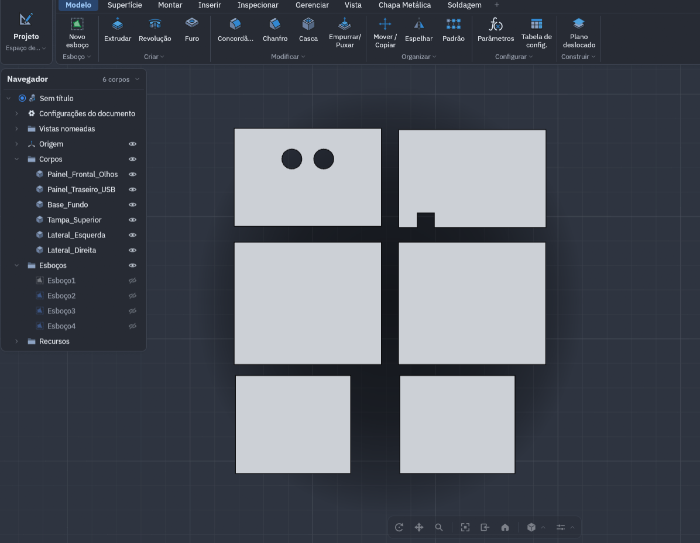
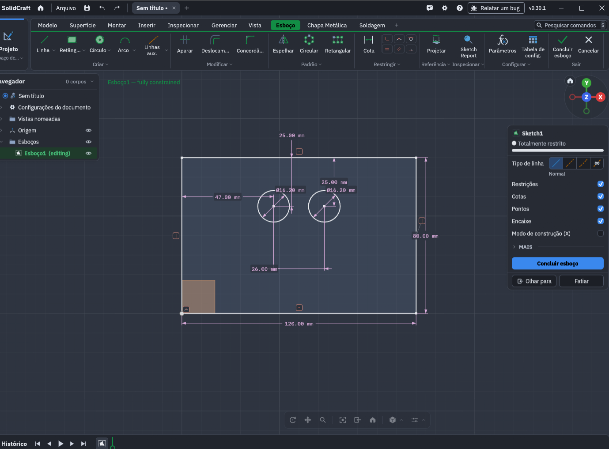
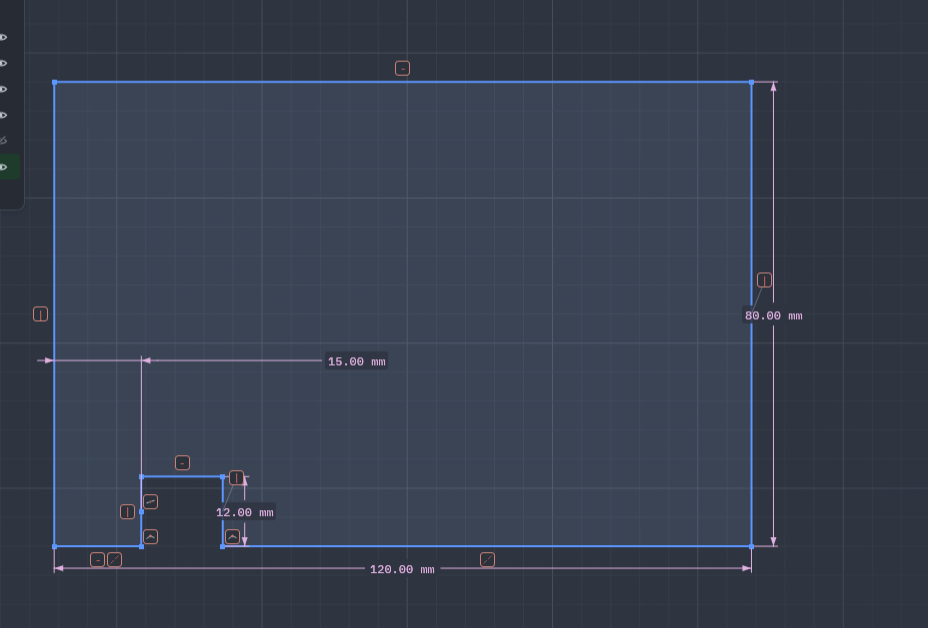
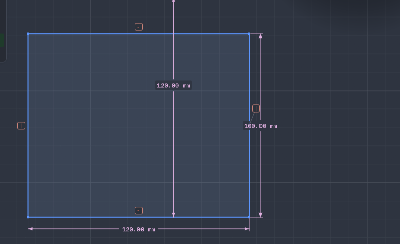
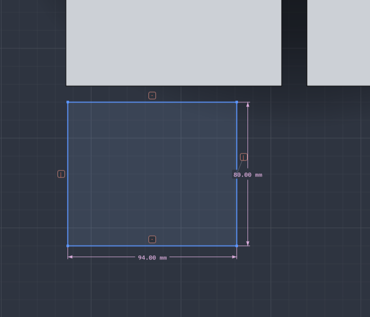
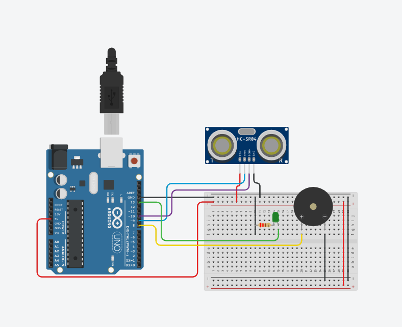

# 🧙‍♂️ Totem Cidadão Bruxo (`bruxo-citizentech`)

[](https://www.fiap.com.br/)
[](https://brasil.un.org/pt-br/sdgs)
[](https://www.python.org/)
[](https://www.arduino.cc/)
[](https://github.com/rany2/edge-tts)
[](https://groq.com/)

> **🎬 Vídeo Demonstrativo (YouTube – Não Listado):** *[Inserir link do YouTube aqui após upload]* — Roteiros (ao vivo e locução em off) + Checklist de entrega em [`docs/ROTEIRO_VIDEO.md`](docs/ROTEIRO_VIDEO.md).

> **👥 Equipe (`4ESR` – FIAP Global Solution 2026):** **Deivison Pertel** (`RM 550803`) · **Eduardo Akira Murata** (`RM 98713`) · **Wesley Souza de Oliveira** (`RM 97874`)

> **Totem interativo acessível com IA generativa, leitura OCR e síntese neural de voz, acionado por aproximação sem toque via sensor ultrassônico HC-SR04 e Arduino Uno R3 em gabinete de MDF 3 mm — projetado para estações de transporte, terminais públicos e postos de atendimento.**

---

## 📋 Ficha Técnica Oficial do MVP (CitizenTech)

| Campo | Especificação |
|---|---|
| **Projeto** | Totem Cidadão Bruxo (`bruxo-citizentech`) |
| **Instituição / Evento** | FIAP – Global Solution (2º Semestre de 2026) |
| **Curso / Turma** | Engenharia de Software – 4º Ano (Turma `4ESR`) |
| **Disciplina** | Project-Based Maker Lab |
| **Docentes Responsáveis** | Prof. Hellynson Cassio Lana, Gedeane Kenshima, Marcus Grillo e Thais Kabuchi |
| **Tema Central** | CitizenTech – Mobilidade, Acessibilidade e Inclusão Urbana |
| **ODS Relacionados** | **ODS 10** (Redução das Desigualdades) e **ODS 11** (Cidades e Comunidades Sustentáveis) |
| **Base de Software** | Assistente Virtual em Python [**Bruxo**](https://github.com/wesley-souza8/bruxo) |
| **Hardware Embarcado** | Arduino Uno R3, Sensor Ultrassônico HC-SR04, LED Verde (resistor 220 Ω), Buzzer Piezoelétrico, Mini-protoboard |
| **Gabinete Físico** | MDF 3 mm modelado parametricamente no **SolidCraft** (`cad/totem_bruxo_makerlab.sc` / `.json` / `-view.dxf`) |
| **Integração Hardware ↔ Software** | Comunicação Serial USB (`9600 baud`) via leitor não-bloqueante em Python (`pyserial`) |
| **Vídeo Demonstrativo (YouTube)** | *[Link Não Listado a inserir após gravação]* ([Roteiro](docs/ROTEIRO_VIDEO.md)) |

### 👥 Integrantes do Grupo
* **Deivison Pertel** – RM `550803`
* **Eduardo Akira Murata** – RM `98713`
* **Wesley Souza de Oliveira** – RM `97874`

---

## 🔄 Como o Robô Opera na Prática (Ciclo Contínuo de 4 Estados)

Totens convencionais de atendimento público dependem de telas sensíveis ao toque e menus visuais complexos, excluindo pessoas cegas, com baixa visão, idosos e cidadãos com mobilidade reduzida. O **Totem Cidadão Bruxo** opera em ciclo contínuo e **100% livre de toque**:

```text
   [1. Modo Standby] ──(Aproximação < 50 cm)──> [2. Gatilho e Boas-Vindas]
          ▲                                                 │
          │                                                 ▼
   [4. Liberação / Standby] <──(Afastamento / "Tchau")── [3. Atendimento por Voz / Visão]
```

1. **Estado 1 — Modo de Espera (`Standby / Vigilância`):**
   * *Hardware:* O sensor HC-SR04 emite pulsos contínuos no Arduino Uno. O LED verde (`D13`) permanece apagado e o buzzer (`D8`) em silêncio.
   * *Software:* `SensorArduino` (`src/sensor_arduino.py`) escuta a porta Serial em segundo plano (sem bloquear a máquina) e registra telemetria de espera quando a distância é `>= 50 cm`, sem disparar voz.
2. **Estado 2 — Detecção Passiva e Saudação Inclusiva (`< 50 cm`):**
   * *Hardware:* Quando o cidadão se aproxima a menos de `50 cm`, o Arduino acende o **LED verde** (feedback visual de atendimento ativo) e o buzzer emite um **bip curto de 100 ms** (`1200 Hz`).
   * *Software:* O Python lê a telemetria serial, abre uma janela de atendimento livre de *wake word* e dispara automaticamente o sintetizador neural (`src/voz.py`):
     > *"Olá! Bem-vindo ao Totem Cidadão. Detectei sua aproximação. Posso orientar seu trajeto, informar serviços ou ler um documento para você. Como posso ajudar?"*
3. **Estado 3 — Interação e Atendimento Acessível (Voz, IA e Visão):**
   * **Orientação Geral / Informações (IA Generativa):** Perguntas como *"Como chego no posto de saúde mais próximo?"*, *"Quais são os serviços essenciais de transporte público disponíveis nesta região?"* ou *"Qual a previsão do tempo para hoje?"* são respondidas em voz clara pela LLM (Groq).
   * **Acessibilidade para Baixa Visão (OCR via Câmera):** Ao dizer *"Bruxo, escanear texto"*, posicionar um documento ou aviso físico na câmera e pressionar `S` na janela de captura, o módulo `src/leitura.py` lê o conteúdo em voz alta via `EasyOCR`.
   * **Identificação Biométrica Facial (Opcional):** Ao dizer *"Bruxo, quem sou eu?"*, o totem identifica usuários cadastrados pela câmera (`src/reconhecimento.py`).
4. **Estado 4 — Liberação e Retorno ao Repouso:**
   * Quando o cidadão se afasta (distância volta a ser superior a `50 cm`) ou se despede (*"Bruxo, tchau"* / *"tchau"*), o LED apaga, a sessão ativa é encerrada e o totem retorna ao **Modo Standby** aguardando o próximo usuário. *(Para encerrar o programa no terminal, diga `"Bruxo, desligar"` ou pressione `Ctrl + C`.)*

---

## 🏗️ Arquitetura do Repositório

```text
bruxo-citizentech/
│
├── .env.example                       # Modelo de variáveis de ambiente (copiar para .env)
├── .gitignore                         # Regras de arquivos ignorados pelo Git
├── requirements.txt                   # Dependências Python (inclui pyserial)
├── main.py                            # Entrypoint: integra SensorArduino + AssistenteBruxo
├── README.md                          # Documentação e Ficha Técnica do MVP
│
├── arduino/
│   └── totem_sensor.ino               # Firmware C++ do Arduino Uno (HC-SR04 + LED + Buzzer + Serial)
│
├── cad/
│   ├── totem_bruxo_makerlab.sc        # Projeto nativo SolidCraft
│   ├── totem_bruxo_makerlab.json      # Modelo paramétrico SolidCraft
│   └── totem_bruxo_makerlab-view.dxf  # Vetor de corte a laser sem arestas ocultas (MDF 3 mm)
│
├── docs/
│   └── ROTEIRO_VIDEO.md               # Roteiro estruturado para o vídeo de até 6 minutos
│
├── img/
│   ├── Base_Fundo_Superior.png        # Cotas CAD: Base e Tampa (120 x 100 mm)
│   ├── Circuito.png                   # Esquemático eletrônico simulado no Tinkercad
│   ├── Laterais.png                   # Cotas CAD: Laterais Esquerda/Direita (94 x 80 mm)
│   ├── Painel_Frontal_Olhos.png       # Cotas CAD: Painel frontal com furos do HC-SR04
│   ├── Painel_Traseiro_USB.png        # Cotas CAD: Painel traseiro com passagem USB
│   ├── Pecas.png                      # Visão geral das 6 faces no SolidCraft
│   └── prints/                        # Capturas geradas em runtime pelo comando de print
│
├── rostos/                            # Datasets locais de biometria facial (ignorado pelo Git)
│
├── tests/
│   └── test_sensor_arduino.py         # Testes unitários do ciclo de 4 estados, parser serial e cooldown
│
└── src/
    ├── __init__.py
    ├── config.py                      # Parâmetros globais, APIs, porta/limiar/sessão do totem
    ├── sensor_arduino.py              # Leitor serial não-bloqueante via pyserial (SensorArduino)
    ├── voz.py                         # Síntese neural Edge-TTS + fallback gTTS + Pygame RAM
    ├── microfone.py                   # Captação de fala (SpeechRecognition) e Wake Word
    ├── ia_groq.py                     # Cliente Groq Cloud LPU com fallback e sanitização
    ├── assistente.py                  # Orquestrador central (4 estados + Dispatcher Pattern)
    ├── leitura.py                     # Leitura OCR de documentos físicos (EasyOCR)
    ├── reconhecimento.py              # Biometria facial com OpenCV LBPH
    ├── agenda.py                      # Persistência de compromissos (agenda.txt)
    ├── captura.py                     # Captura e limpeza de prints de tela
    ├── servicos.py                    # Clima, cotação, mídia e utilidades web
    └── easter_eggs.py                 # Respostas clássicas e interações extras
```

---

## 🛠️ Guia de Montagem Física e Instalação

Este guia detalha a fabricação digital do gabinete, a montagem do circuito eletrônico e a integração do hardware com o assistente inteligente Bruxo.

### 1. Lista de Materiais e Componentes

| Item | Componente | Qtd. | Observações |
| :---: | :--- | :---: | :--- |
| **1** | Placa de MDF cru (espessura `3 mm`) | 1 chapa (`30 × 40 cm`) | Para corte a laser das 6 faces do gabinete |
| **2** | Cola de madeira (PVA) ou fita dupla-face acrílica | 1 un. | Fixação das paredes da caixa de MDF |
| **3** | Microcontrolador **Arduino Uno R3** + Cabo **USB Tipo B** | 1 kit | Placa controladora e comunicação serial |
| **4** | **Sensor Ultrassônico HC-SR04** | 1 un. | 4 pinos (`VCC`, `TRIG`, `ECHO`, `GND`) |
| **5** | **Mini-Protoboard** (170 pontos) | 1 un. | Fixação interna de componentes e jumpers |
| **6** | **LED Difuso 5 mm Verde** | 1 un. | Sinalizador visual de atendimento ativo |
| **7** | **Resistor de 220 Ω** (`1/4 W`) | 1 un. | Limitador de corrente (Vermelho-Vermelho-Marrom) |
| **8** | **Buzzer Piezoelétrico** (5 V) | 1 un. | Feedback sonoro curto de aproximação |
| **9** | **Cabos Jumpers** (Macho-Fêmea e Macho-Macho) | 10 un. | Conexão entre placa, sensor e protoboard |

---

### 2. Fabricação Digital do Gabinete (Corte a Laser — SolidCraft / DXF)

O gabinete fechado foi modelado parametricamente no **SolidCraft** respeitando a espessura de `3 mm` do MDF, com arquivo vetorial exportado sem arestas ocultas em [`cad/totem_bruxo_makerlab-view.dxf`](cad/totem_bruxo_makerlab-view.dxf).

1. Baixe o arquivo vetorial [`cad/totem_bruxo_makerlab-view.dxf`](cad/totem_bruxo_makerlab-view.dxf) (ou abra o projeto [`cad/totem_bruxo_makerlab.sc`](cad/totem_bruxo_makerlab.sc) / [`.json`](cad/totem_bruxo_makerlab.json)).
2. Carregue o `.dxf` no software da cortadora a laser do Maker Lab (ex.: **LightBurn** / **RDWorks**).
3. Configure os parâmetros sugeridos para **MDF 3 mm**:
   * **Corte (contornos externos e furos):** Potência `~65% a 75%`, Velocidade `~15 a 20 mm/s` *(ajustar conforme calibração do tubo da máquina)*.
4. Confira as **6 peças cortadas**:



| Peça | Dimensões (mm) | Detalhes Construtivos | Referência Visual |
|---|---|---|---|
| `Painel_Frontal_Olhos` | `120 × 80` | 2 furos circulares `Ø 16,2 mm` para o HC-SR04 (`25 mm` do topo, `47 mm` da borda esquerda, `26 mm` entre centros) | [Ver cotas](img/Painel_Frontal_Olhos.png) |
| `Painel_Traseiro_USB` | `120 × 80` | Recorte inferior em `"U"` invertido de `14 × 12 mm` (a `15 mm` da borda esquerda) para passagem do cabo USB | [Ver cotas](img/Painel_Traseiro_USB.png) |
| `Base_Fundo` | `120 × 100` | Chapa lisa inferior de apoio do Arduino e protoboard | [Ver cotas](img/Base_Fundo_Superior.png) |
| `Tampa_Superior` | `120 × 100` | Chapa lisa removível para inspeção e manutenção | [Ver cotas](img/Base_Fundo_Superior.png) |
| `Lateral_Esquerda` | `94 × 80` | Fechamento lateral reto (`100 mm - 2 × 3 mm` do MDF) | [Ver cotas](img/Laterais.png) |
| `Lateral_Direita` | `94 × 80` | Fechamento lateral reto (`100 mm - 2 × 3 mm` do MDF) | [Ver cotas](img/Laterais.png) |

<details>
<summary>Visualizar todas as imagens de cotas das peças do gabinete</summary>

| Painel Frontal (Olhos HC-SR04) | Painel Traseiro (Saída USB) |
|---|---|
|  |  |

| Base e Tampa Superior | Laterais (94 × 80 mm) |
|---|---|
|  |  |

</details>

---

### 3. Montagem do Circuito Eletrônico (Tinkercad)

Consulte a simulação validada em [`img/Circuito.png`](img/Circuito.png) e faça as ligações com o Arduino desconectado do computador:



```text
      +---------------------------------------------+
      |                 ARDUINO UNO                 |
      |  [5V]   [GND]   [D8]   [D9]   [D10]   [D13] |
      +---|-------|-------|------|------|-------|---+
          |       |       |      |      |       |
          |       |       |      |      |       +---> LED Verde (+) [220 Ω -> GND]
          |       |       |      |      +-----------> HC-SR04 (ECHO)
          |       |       |      +------------------> HC-SR04 (TRIG)
          |       |       +-------------------------> Buzzer Piezo (+) [(-) -> GND]
          |       +---------------------------------> Barramento (-) Protoboard (GND)
          +-----------------------------------------> Barramento (+) Protoboard (+5V / HC-SR04 VCC)
```

#### Tabela de Pinagem

| Componente | Pino / Terminal | Conexão no Arduino Uno R3 | Função |
|---|---|---|---|
| **HC-SR04** | `VCC` | `5V` (via barramento `+` da protoboard) | Alimentação 5 V |
| **HC-SR04** | `GND` | `GND` (via barramento `-` da protoboard) | Referência terra |
| **HC-SR04** | `TRIG` | Pino Digital **`9`** (fio azul) | Disparo do pulso ultrassônico |
| **HC-SR04** | `ECHO` | Pino Digital **`10`** (fio roxo) | Leitura do retorno do eco |
| **LED Verde** | Ânodo (`+` longo) | Pino Digital **`13`** (fio verde) | Sinalização visual de atendimento ativo |
| **LED Verde** | Cátodo (`-` curto) | Em série com Resistor `220 Ω` → `GND` | Limitação de corrente do LED |
| **Buzzer Piezo** | Positivo (`+`) | Pino Digital **`8`** (fio amarelo) | Bip sonoro acessível (`tone`) |
| **Buzzer Piezo** | Negativo (`-`) | `GND` | Referência terra |

#### Lógica do Firmware (`arduino/totem_sensor.ino`)
1. Opera na taxa serial de **`9600 baud`**.
2. Emite pulsos ultrassônicos no pino `9` e mede o eco no pino `10` (com timeout de `30 ms` para ~5 metros e prevenção de falso positivo `0 cm`).
3. Quando a distância medida é válida (`> 0`) e **`<= 50 cm`** (`DISTANCIA_GATILHO`):
   * Acende o **LED Verde** (`D13`);
   * Emite o bip curto de confirmação no **Buzzer** (`D8`, `1200 Hz` por `100 ms`).
4. Quando a distância é superior a `50 cm`, mantém o LED apagado e o buzzer silenciado (`noTone`).
5. Envia toda leitura válida (`distancia > 0`) pela Serial (`Serial.println(distancia)`) a cada `200 ms`, permitindo tanto o gatilho `< 50 cm` quanto a telemetria de **Standby (`> 50 cm`)** no Python (`src/sensor_arduino.py`).

---

### 4. Integração Mecânica na Caixa de MDF

1. **Fixação do Sensor Frontal:** Encaixe os dois cilindros transdutores do **HC-SR04** de dentro para fora nos dois furos de `Ø 16,2 mm` do `Painel_Frontal_Olhos`, pressionando suavemente até o batente facear o MDF *(se necessário, aplique uma gota de cola quente na parte traseira da placa do sensor)*.
2. **Posicionamento da Eletrônica:**
   * Cole a base adesiva da **mini-protoboard** sobre a `Base_Fundo`.
   * Posicione o **Arduino Uno R3** sobre a base alinhando o conector **USB-B** diretamente com a fenda em `"U"` do `Painel_Traseiro_USB`.
3. **Colagem das Paredes:**
   * Aplique cola de madeira PVA nas bordas de junção do `Painel_Frontal_Olhos`, `Painel_Traseiro_USB`, `Lateral_Esquerda` e `Lateral_Direita` sobre a `Base_Fundo`.
   * Mantenha as peças em esquadro por ~10 minutos com auxílio de fita crepe até a cura inicial.
4. **Fechamento com Tampa Removível:**
   * A `Tampa_Superior` (`120 × 100 mm`) deve permanecer **solta/apenas encaixada** por cima, garantindo acesso rápido aos circuitos para manutenção e demonstração interna durante a gravação do vídeo.
5. **Conexão ao Computador Host:** Passe o cabo USB-B pelo rasgo traseiro e conecte o Arduino ao computador que executará o assistente **Bruxo** (com microfone, webcam e saída de áudio ativos).

---

### 5. Configuração de Software e Execução

#### Passo A: Gravação do Firmware no Arduino Uno
1. Abra a **Arduino IDE** e conecte o cabo USB do Arduino ao computador.
2. Abra o arquivo [`arduino/totem_sensor.ino`](arduino/totem_sensor.ino).
3. Em **Ferramentas → Placa**, selecione **Arduino Uno**; em **Ferramentas → Porta**, selecione a porta serial identificada (ex.: `COM3` no Windows ou `/dev/ttyACM0` no Linux).
4. Clique em **Carregar (Upload)** e feche o Monitor Serial da IDE antes de iniciar o Python (para liberar a porta COM).

#### Passo B: Instalação e Execução do Assistente Bruxo

1. **Clonar o repositório e acessar a pasta:**
   ```bash
   git clone https://github.com/wesley-souza8/bruxo-citizentech.git
   cd bruxo-citizentech
   ```
2. **Criar e ativar o ambiente virtual:**
   ```powershell
   python -m venv venv

   # No Windows (PowerShell):
   .\venv\Scripts\Activate.ps1

   # No Linux/macOS:
   # source venv/bin/activate
   ```
3. **Instalar as dependências Python:**
   ```bash
   pip install -r requirements.txt
   ```
   > **Nota:** Mantenha `opencv-contrib-python` (suporte a `cv2.face`) e `pyserial` (leitura serial do Arduino).
4. **Configurar variáveis de ambiente (`.env`):**
   ```powershell
   Copy-Item .env.example .env
   ```
   Preencha suas chaves no `.env`:
   ```env
   GROQ_API_KEY=sua_chave_groq_aqui
   OPENWEATHER_API_KEY=sua_chave_openweathermap_aqui
   AWESOME_API_KEY=sua_chave_awesomeapi_aqui

   # Deixe vazio para detecção automática ou informe a porta (ex: COM3)
   ARDUINO_PORTA=
   ARDUINO_BAUDRATE=9600
   DISTANCIA_ATIVACAO_CM=50
   COOLDOWN_TOTEM_SEGUNDOS=30
   DURACAO_SESSAO_TOTEM_SEGUNDOS=45
   ```
5. **Iniciar o Totem:**
   ```powershell
   python main.py
   ```

1. O `SensorArduino` (`src/sensor_arduino.py`) detecta automaticamente a porta COM do Arduino e inicia a leitura em **thread não-bloqueante** (`9600 baud`), exibindo telemetria de **Standby** enquanto não houver ninguém a `< 50 cm`.
2. Ao se aproximar a **menos de 50 cm** do totem:
   * O LED verde acende e o buzzer emite o bip curto de `100 ms`;
   * O Bruxo fala automaticamente via voz neural (`src/voz.py`):
     *"Olá! Bem-vindo ao Totem Cidadão. Detectei sua aproximação. Posso orientar seu trajeto, informar serviços ou ler um documento para você. Como posso ajudar?"*
3. Após a saudação, o cidadão pode falar perguntas diretamente ou usando **"Bruxo, ..."** (IA generativa, leitura OCR de documentos, clima, reconhecimento facial, etc.).
4. Ao se afastar (`> 50 cm`) ou dizer **"Bruxo, tchau"**, o totem volta ao **Modo Standby**.
5. Para encerrar o programa por completo no terminal, diga **"Bruxo, desligar"** ou pressione `Ctrl + C`.

### 🧪 Executar Testes Unitários (Sem Necessidade de Hardware Conectado)
```powershell
python -m unittest discover -s tests -v
```

---

## 🗣️ Principais Comandos de Voz do Totem Bruxo

| Comando | Ação |
|---|---|
| *Fala livre após aproximação (`< 50 cm`)* ou **"Bruxo, [qualquer pergunta]"** | Responde dúvidas cidadãs e trajetos usando IA Generativa (Groq Cloud) |
| **"Bruxo, escanear texto"** | Lê documentos/avisos físicos pela webcam via OCR (`EasyOCR`) |
| **"Bruxo, quem sou eu?"** | Identifica cidadão/operador cadastrado via biometria facial (`OpenCV`) |
| **"Bruxo, previsão do tempo"** | Consulta clima em tempo real via OpenWeather |
| **"Bruxo, que horas são?"** / **"que dia é hoje?"** | Informa horário e data atuais por voz |
| **"Bruxo, quem é você?"** / **"se apresente"** | Apresenta a identidade e funcionalidades do assistente |
| **"Bruxo, tchau"** *(ou afastar-se `> 50 cm`)* | Finaliza o atendimento atual e retorna ao **Modo Standby** |
| **"Bruxo, desligar"** *(ou `Ctrl + C`)* | Encerra a aplicação Python e fecha a porta serial com segurança |
